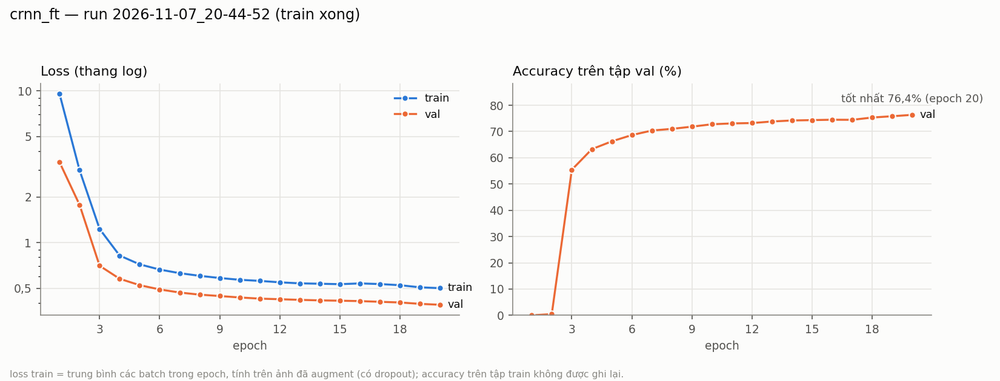
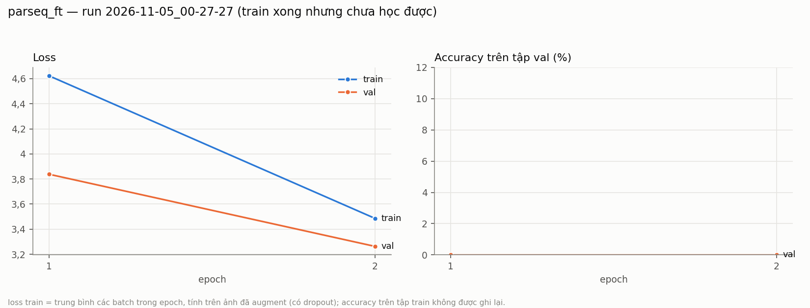
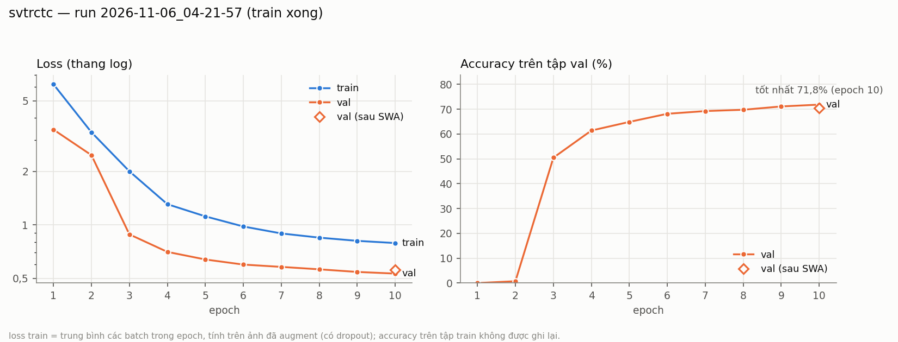
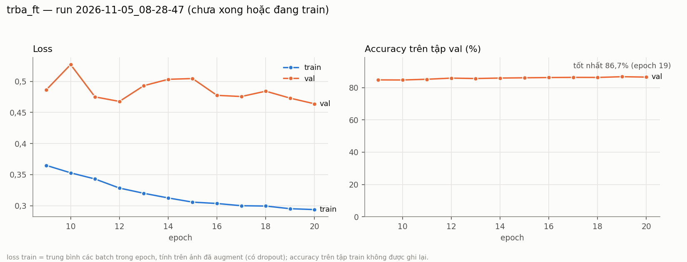

# Tổng kết: Dữ liệu train/test và quá trình huấn luyện

*Tài liệu tổng hợp cho nhánh `16-fix-review`, cập nhật lần cuối **15/11/2026** từ dữ liệu thực tế trong `data/` và kết quả đánh giá trong `reports/`.*

## 1. Nguồn dữ liệu (train / test)

### 1.1 Tập huấn luyện & đánh giá - Hoa Kỳ (USPTO)

#### Nguồn dữ liệu và link tải

Dữ liệu **không có sẵn một gói tải cố định** mà được thu thập trực tiếp từ **USPTO EOG/TMOG REST API** (công khai, không cần API key) rồi tái lập bằng pipeline các nhánh `02`, `03`, `04`, `05`.

> **Phạm vi mục 1.1:** số liệu **5.000 ảnh** dưới đây là **bản thử nghiệm cục bộ** từ 5.000 dòng metadata đầu (một issue), dùng để kiểm chứng pipeline. **Bản huấn luyện đầy đủ** là các LMDB ở mục 1.3 (train **51.230** mẫu); ảnh của bản đầy đủ đã **nhúng trong `data.mdb`**, không nằm trong `raw/images_us/`.

**Nguồn USPTO:** đây là một luồng thu thập dữ liệu (data pipeline) chuẩn để xây dựng cơ sở dữ liệu nhãn hiệu từ Cơ quan Sáng chế và Nhãn hiệu Hoa Kỳ

**Lý do chọn nguồn:**
(1) công khai, **không cần API key**;
(2) API trả đúng trường cần và phân trang nhẹ hơn nhiều so với tải XML gazette 80–105 MB/issue;
(3) có sẵn **nhãn chữ + mã loại hình** để lọc nhãn hiệu có chữ;
(4) metadata và ảnh khớp nhau qua serial/ngày công bố nên tái lập được. Các nguồn thay thế (`bulkdata.uspto.gov`, `trademarks.reedtech.com`) đã ngừng hoạt động; `api.uspto.gov` yêu cầu API key.

| Thành phần                                                                                                                  | Link / lệnh tải                                                                        |
|-----------------------------------------------------------------------------------------------------------------------------|----------------------------------------------------------------------------------------|
| Mã nguồn + script tái lập dữ liệu                                                                                           | `https://github.com/nguyenlamvu123/major_proj_1.git` (nhánh `16-fix-review`)           |
| PUBLICATIONS_ENDPOINT của API metadata, src/trademark_ocr/fetch_meta.py gửi GET requests để lấy danh sách issue gazette     | `https://tm-eog-service.uspto.gov/eog-rest-service/api/external/search/publications`   |
| SEARCH_ENDPOINT của API metadata, src/trademark_ocr/fetch_meta.py gửi POST requests để tải bản ghi nhãn hiệu của từng issue | `https://tm-eog-service.uspto.gov/eog-rest-service/api/external/search/all`            |
| Ảnh USPTO, src/trademark_ocr/fetch_images.py gửi GET requests tới CDN | https://cdn.uspto.gov/img/{serial_number}/{publicationDate}/{size} trong đó serial_number, publication_date lấy từ metadata (us_marks.csv)           |
| Notebook tải & chuẩn bị dữ liệu (Colab, CPU)                                                                                | `docs/colab/01_download_data.ipynb`                                                    |
| Metadata USPTO (text, 18 cột)                                                                                               | `python -m trademark_ocr.fetch_meta --limit 6000` → `$DATA_ROOT/raw/meta/us_marks.csv` |
| Ảnh nhãn hiệu USPTO (CDN)                                                                                                   | `python -m trademark_ocr.fetch_images` → `$DATA_ROOT/raw/images_us/`                   |

> Trên máy hiện tại, dữ liệu nằm trong `data/` của repo (tức `DATA_ROOT="$PWD/data"`); `/media/zaibachkhoa/AC84-F995/trademark_data` là nơi lưu bản thử nghiệm 5.000 ảnh ban đầu. Trên Colab, dữ liệu US được tải vào ổ máy ảo `/content/trademark_data` rồi sao lưu `raw/meta/`, `raw/images_us.tar`, `processed/`, `lmdb/` lên `MyDrive/trademark_data/`.

#### Mô tả dữ liệu

- **Bài toán**: nhận dạng **một dòng chữ** trên toàn bộ ảnh nhãn hiệu (chưa có bước phát hiện vùng chữ): đầu vào là ảnh nhãn hiệu, đầu ra là chuỗi `word_mark`.
- Đây là bài toán **phân loại ở cấp ký tự/token** (sequence labeling / structured prediction), không phải hồi quy.
- Số lớp là cấp ký tự, không phải mỗi nhãn hiệu một lớp. Bảng nhãn có **217 ký tự** (`configs/hydra/charset/charset_vi.yaml`: chữ hoa/thường, chữ có dấu, số, dấu câu, khoảng trắng); số đầu ra phụ thuộc tokenizer:
  - Số đầu ra theo từng mô hình:
    - **CTC** (CRNN, SVTR-CTC): **218** = 217 ký tự + `blank`.
    - **PARSeq**: **218** = 217 ký tự + `EOS` (head bỏ `BOS`/`PAD`).
    - **TRBA**: **220** logits = 217 ký tự + `EOS` + `BOS` + `PAD`; chỉ dự đoán ký tự + `EOS` (`PAD` bị ignore, `BOS` chỉ làm input).
- **Metadata**: `raw/meta/us_marks.csv` — **6000 dòng**, 18 cột (chủ yếu `serial_number`, `word_mark`, `mark_drawing_cd`, `drawing_kind`, `publication_date`, `owner`, `us_class`, `image_url`…). Thống kê: `raw/meta/us_marks.csv.stats.json`.
- **Ảnh**: `raw/images_us/{serial_number}.png` — **5000 ảnh rời (bản thử nghiệm)** tải từ CDN USPTO (trung bình ~33 KB/ảnh); **1000 dòng metadata còn lại** có `image_status=pending` do lần chạy `fetch_images` chỉ xử lý 5000 dòng đầu, không phải ảnh lỗi. Sổ đăng ký ảnh: `raw/images_us/index.csv` (5000 dòng `ok`, kích thước, sha1…).
- **Nhãn chữ**: Unicode **NFC**, giữ nguyên hoa/thường và dấu, độ dài 2–25 ký tự (mean ≈ 10.65), bảng ký tự 217 ký tự (`configs/hydra/charset/charset_vi.yaml`).
- **Phân bố theo loại nhãn hiệu** (trong 4840 mẫu sạch): `standard_character` 3341, `design_with_words` 853, `stylized_words` 410, `typeset_old` 236.
- **Lưu ý**: nhãn USPTO hầu như viết HOA; ảnh nhãn hiệu thường là ảnh nguyên (logo/nhiều dòng), không phải ảnh dòng chữ đã cắt.

#### Các thao tác làm sạch dữ liệu (nhánh `04`)

Đầu vào là 5000 dòng metadata đầu tiên (tham số `limit=5000`) + ảnh tương ứng trong `index.csv`. Thứ tự lọc cố định:

1. **Chuẩn hoá nhãn**: NFC → gộp khoảng trắng liên tiếp → `strip`.
2. **`no_text`**: nhãn rỗng sau chuẩn hoá.
3. **`too_short`**: nhãn < 2 ký tự.
4. **`too_long`**: nhãn > 25 ký tự (vượt `max_label_length` của mô hình).
5. **`unsupported_char`**: chứa ký tự ngoài bảng ký tự 217 ký tự.
6. **`missing_image`**: không có ảnh `status=ok` trong `index.csv`.
7. **`bad_image`**: file ảnh hỏng/không mở được (kiểm bằng PIL `probe_image`).
8. **`duplicate_label`**: trùng chuỗi nhãn (giữ 1 mẫu; có thể tắt bằng `--no-dedupe`).

Kết quả: **giữ 4840/5000** (`keep_ratio = 0.968`), chỉ rớt **160 `duplicate_label`** (các lý do text đã được lọc từ nhánh `02`). Báo cáo đầy đủ: `processed/clean_report.json`.

> Ở bước thu thập metadata (6000 dòng), nhánh `02` đã loại: `too_long` 517, `design_without_word` 305, `too_short` 72, `unsupported_char` 29. Nhánh `04` chỉ xử lý 5000 dòng đầu nên 1000 dòng metadata còn lại **chưa** được đưa vào tập sạch hiện tại.

#### Chia tập train/val/test (nhánh `05`)

- **Cách chia**: gom các dòng theo **nhóm nhãn** (`word_mark`) rồi trộn **nhóm** bằng seed cố định `1111` → tránh cùng một nhãn xuất hiện ở cả train và test (label leakage).
- **Tỉ lệ**: **90% train / 5% val / 5% test US**. Sau khi nhánh `04` dedupe, mỗi nhãn chỉ còn 1 dòng nên số nhóm = số dòng.
- **Kết quả**: train **4356**, val **242**, test US **242**. Kiểm tra chồng lấn: **0** nhãn và **0** serial giữa mọi cặp tập.
- **Tính tất định**: cùng seed `1111` cho cùng kết quả; báo cáo: `processed/split_report.json`.

| Thành phần | Vị trí (dưới `DATA_ROOT`) | Số lượng / ghi chú |
|---|---|---|
| Metadata thô | `raw/meta/us_marks.csv` + `.stats.json` | 6000 dòng, 18 cột |
| Ảnh gốc | `raw/images_us/` + `index.csv` | 5000 ảnh PNG từ CDN USPTO (1000 metadata còn `pending`) |
| Dữ liệu đã làm sạch | `processed/clean.csv` + `clean_report.json` | **4840** mẫu (giữ 96.8%) |
| Chia tập | `processed/split_train.csv` (4356), `split_val.csv` (242), `split_test_us.csv` (242) | 90/5/5 theo nhóm nhãn, seed 1111, overlap = 0 |
| EDA | `processed/eda_figures/` (`fig_*.png`) | Nhánh 06 |

### 1.2 Tập đánh giá mới - Việt Nam (IP Vietnam / WIPO Publish)

Thu thập bằng scraper **WIPO Publish** (nhánh 11), đã được cải thiện ở nhánh `16-fix-review` (§16.5: crawl qua trang trống, dedupe, lọc `registered-only`, công cụ duyệt tay).

**Nguồn WIPO Publish:** cổng tra cứu nhãn hiệu công khai của **IP Vietnam** (Cục Sở hữu trí tuệ) chạy trên nền **WIPO Publish** (`https://wipopublish.ipvietnam.gov.vn/wopublish-search`). Mỗi bản ghi cung cấp nhãn chữ `rs-MK`, số đơn, ngày nộp/công bố, số đăng ký, chủ đơn, nhóm Nice, trạng thái và **ảnh thumbnail** của nhãn.

**Lý do chọn nguồn:**
(1) là nguồn **công khai, chính thống** cho nhãn hiệu Việt Nam;
(2) có **cả nhãn chữ và ảnh** nên dùng trực tiếp làm tập test domain shift US→VN;
(3) nhãn tiếng Việt **có dấu, phân biệt hoa/thường**, khác phân bố USPTO (hầu như viết HOA, ít dấu) → kiểm tra khả năng tổng quát của mô hình;
(4) không cần API key/đăng ký, dù phải crawl Wicket/AJAX và chấp nhận TLS tự ký.

| Thành phần | Link / lệnh tải |
|---|---|
| Mã nguồn + script tái lập dữ liệu VN | `https://github.com/nguyenlamvu123/major_proj_1.git` (nhánh `16-fix-review`), `src/trademark_ocr/fetch_vn.py` |
| Notebook tải & chuẩn bị dữ liệu (Colab, CPU) | `docs/colab/01_download_data.ipynb` — mục **VN — crawl, duyệt tay, LMDB** |
| Metadata + ảnh VN | `python -m trademark_ocr.fetch_vn --limit 50` → `$DATA_ROOT/raw/vn_marks.csv`, `raw/vn_report.json`, `raw/images_vn/<id>.jpg` (đã fix mismatch `reg_no`/`registration_no`) |
| Split test VN | cùng lệnh trên ghi `processed/split_test_vn.csv` (**50 dòng**, mục tiêu ~1–2k) + `processed/test_vn.txt`; đóng gói LMDB: `python -m trademark_ocr.build_lmdb --subset test_vn` |
| Duyệt tay nhãn VN | `python -m trademark_ocr.vn_review make --n 50` → `processed/review_vn.csv`, `review_vn.html`; sửa xong chạy `python -m trademark_ocr.vn_review apply` → `split_test_vn_verified.csv`, `review_vn_report.json` |
| Endpoint khởi tạo phiên (GET) | `GET https://wipopublish.ipvietnam.gov.vn/wopublish-search/public/trademarks?query=*:*` → lấy form id, URL behavior `searchSubmitLink`, `Wicket.Ajax.baseUrl` (TLS tự ký → `verify=False`) |
| Endpoint tìm kiếm (POST AJAX) | `POST <searchSubmitLink behavior URL>`; headers `Wicket-Ajax: true`, `Wicket-Ajax-BaseURL`, `X-Requested-With: XMLHttpRequest`; body `<fid>_hf_0=&intelligentSearchInput=&searchSubmitLink=Tra+cuu` → panel **50 hàng/trang** |
| Phân trang (GET AJAX) | `GET <navigator-next URL>` với cùng header AJAX → tải trang kế tiếp |
| Ảnh thumbnail (GET) | `GET https://wipopublish.ipvietnam.gov.vn/wopublish-search/service/trademarks/application/{id}/thumbnail?noLogo=true&disclaimer=Combined` → JPEG |

### 1.3 Định dạng LMDB dùng để huấn luyện/đánh giá

Toàn bộ dữ liệu đưa về định dạng **LMDB** theo layout của parseq (nhánh 05). Đã sửa bug quan trọng ở nhánh `16-fix-review` (16.1): quản lý transaction thủ công, commit đúng batch cuối + ghi `num-samples` (trước đây bị lỗi khi >=1000 mẫu).

LMDB = *Lightning Memory-Mapped Database* — cơ sở dữ liệu key-value nhúng, lưu trong 2 file `data.mdb` + `lock.mdb`, truy cập qua memory-mapping nên đọc nhanh và nhiều worker có thể đọc đồng thời.

Bản LMDB dùng để huấn luyện trên Colab:

| Tập | Đường dẫn LMDB | `num-samples` |
|---|---|---|
| Train | `data/lmdb/train/trademark/` | `51230` |
| Val | `data/lmdb/val/` | `2846` |
| Test US | `data/lmdb/test/test_us/` | `2847` |
| Test VN | `data/lmdb/test/test_vn/` | `2000` |

> **Phân biệt bản dữ liệu:** mục 1.1–1.2 mô tả bản thử nghiệm (5.000 ảnh rời US, 50 mẫu VN); các LMDB trong bảng trên là **bản huấn luyện đầy đủ** trên Colab (56.923 mẫu US + 2.000 mẫu VN), với ảnh **nhúng trực tiếp trong `data.mdb`**.

## 2. Quá trình huấn luyện

### 2.1 Mô hình sử dụng

Repo tích hợp với **[baudm/parseq](https://github.com/baudm/parseq)** (clone vào `third_party/parseq`, không fork, không sửa). Trên nhánh `16-fix-review` có **7 cấu hình huấn luyện** trên cùng một LMDB: **4 mô hình train từ đầu** và **3 biến thể fine-tune**.

| # | Cấu hình | Config (trong `configs/hydra/`) | Kiến trúc / loss | Khởi tạo | Ghi chú |
|---|---|---|---|---|---|
| 1 | **CRNN** | `tm_crnn.yaml` | ResNet + BiLSTM + CTC | Từ đầu | Dùng `strhub.models.crnn` của parseq |
| 2 | **TRBA** | `tm_trba.yaml` | TPS + ResNet + BiLSTM + Attention | Từ đầu | Dùng `strhub.models.trba` của parseq |
| 3 | **PARSeq** | `tm_parseq.yaml` | Transformer encoder-decoder (Permuted Autoregressive Sequence) | Từ đầu | Dùng `strhub.models.parseq` của parseq |
| 4 | **SVTR-CTC** | `tm_svtrctc.yaml` | SVTR-Lite + CTC; 32 cột thời gian (sửa ở 16.2) | Từ đầu | **Tự viết** trong `src/trademark_ocr/svtr_ctc.py`; không có pretrained trong parseq; checkpoint cũ **không tương thích** |
| 5 | **CRNN-FT** | `tm_crnn_ft.yaml` | CRNN + CTC | Pretrained `crnn` của parseq | Run riêng, `init_from: crnn` |
| 6 | **TRBA-FT** | `tm_trba_ft.yaml` | TRBA | Pretrained `trba` của parseq | Run riêng, `init_from: trba` |
| 7 | **PARSeq-FT** | `tm_parseq_ft.yaml` | PARSeq | Pretrained `parseq` của parseq | Run riêng, `init_from: parseq` |

**Điểm chung:** cả 7 cấu hình dùng chung `data/lmdb/train/trademark`, cùng charset 217 ký tự và cùng đầu ra `word_mark`. Trong đó:  
- **CTC (Connectionist Temporal Classification)** — không phải một mô hình riêng mà là **hàm loss + cách giải mã** cho bài toán chuỗi: căn chuỗi đặc trưng ảnh với chuỗi nhãn mà không cần căn chỉnh từng ký tự, dùng token `blank` rồi gộp các bước lặp khi decode. Trong đồ án, CTC là **nhánh baseline/đối chứng**: **CRNN + CTC** (baseline cổ điển) và **SVTR-CTC** (Transformer + CTC, hiện đại hơn). Đầu ra 218 logits = 217 ký tự + `blank`.
- **TRBA (TPS + ResNet + BiLSTM + Attention)** — mô hình **attention-based** đại diện cho hướng decoder tự hồi quy: TPS hiệu chỉnh biến dạng ảnh, ResNet + BiLSTM trích đặc trưng, decoder attention sinh ký tự lần lượt và dùng `EOS` để dừng. Vai trò: **so sánh trực tiếp với nhánh CTC**, train từ đầu trên cùng charset và cùng tập dữ liệu.
- **PARSeq (Permuted Autoregressive Sequence)** — mô hình **Transformer encoder-decoder** đại diện SOTA trong 4 mô hình, dùng permutation language modeling để học ngữ cảnh hai chiều khi train. Vai trò kép: (1) **ứng viên được kỳ vọng** cho kết quả tốt nhất; (2) kho trọng số pretrained của `baudm/parseq` cung cấp bản tương ứng từng kiến trúc (`crnn`, `trba`, `parseq`) để khởi tạo `crnn_ft` / `trba_ft` / `parseq_ft` — chỉ nạp các tensor cùng tên và cùng kích thước, bỏ phần head phụ thuộc charset (DESIGN 16.6).
- **CRNN** là baseline tối giản (CNN + BiLSTM + CTC); **SVTR-CTC** là nhánh CTC hiện đại (Vision Transformer) để kiểm chứng CTC vẫn cạnh tranh khi kiến trúc encoder tốt hơn. Cả 4 mô hình dùng **cùng đầu vào ảnh nhãn hiệu, cùng đầu ra chuỗi `word_mark`, cùng charset 217 ký tự**; khác nhau ở kiến trúc, loss và cách giải mã. Các biến thể `*_ft` không phải kiến trúc mới mà là **cùng mô hình, khởi tạo từ pretrained** để so sánh công bằng giữa "train từ đầu" và "fine-tune".  
- **SVTR-CTC** là kiến trúc tự viết thêm trong `src/trademark_ocr/svtr_ctc.py`, chỉ dùng chung framework train/data của parseq.
- Các biến thể `*_ft` **không phải kiến trúc mới** và là **run riêng**, không nối tiếp checkpoint train-from-scratch: nạp pretrained weights tương ứng (`crnn`/`trba`/`parseq` của parseq, huấn luyện trên REBU-SynText/COCO-Text), bỏ head phụ thuộc charset rồi fine-tune trên dữ liệu nhãn hiệu.

**Bảng ký tự:** Tiếng Việt Unicode NFC, cấu hình tại `configs/charset/charset_vi.yaml` và `src/trademark_ocr/charset.py`. Đã đảm bảo `charset_test == charset_train` và xử lý đúng 2 bẫy parseq: `normalize_unicode: false`, `remove_whitespace: false`.

### 2.2 Cách chạy huấn luyện

Huấn luyện chạy trực tiếp `third_party/parseq/train.py` qua Hydra (`--config-dir configs/hydra --config-name ...`).

Cả 7 cấu hình đọc **train LMDB** tại `data/lmdb/train/trademark` (hoặc `$DATA_ROOT/lmdb/train/trademark`); và đánh giá tại `val`/`test_us`/`test_vn`. Mỗi lần chạy chỉ khác `--config-name`.

**Chuẩn bị môi trường:**

```bash
# Bản LMDB tải trong repo: không đặt DATA_ROOT để dùng mặc định data/lmdb
unset DATA_ROOT
# export DATA_ROOT=/đường/dẫn/trademark_data   # chỉ khi dữ liệu nằm ngoài repo
export PYTHONPATH=$PWD/compat:$PWD/src:$PWD/third_party/parseq
```

**Train từ đầu:**

```bash
# CRNN + CTC
python third_party/parseq/train.py --config-dir configs/hydra --config-name tm_crnn

# TRBA
python third_party/parseq/train.py --config-dir configs/hydra --config-name tm_trba

# PARSeq
python third_party/parseq/train.py --config-dir configs/hydra --config-name tm_parseq

# SVTR-CTC
python third_party/parseq/train.py --config-dir configs/hydra --config-name tm_svtrctc
```

**Fine-tune (khởi tạo từ pretrained tương ứng):**

```bash
# PARSeq-FT — init_from: parseq
python third_party/parseq/train.py --config-dir configs/hydra --config-name tm_parseq_ft

# CRNN-FT — init_from: crnn
python third_party/parseq/train.py --config-dir configs/hydra --config-name tm_crnn_ft

# TRBA-FT — init_from: trba
python third_party/parseq/train.py --config-dir configs/hydra --config-name tm_trba_ft
```

**Smoke test trên CPU** (không đủ cho train thật):

```bash
python third_party/parseq/train.py --config-dir configs/hydra --config-name tm_crnn \
  trainer.limit_train_batches=2 trainer.max_epochs=1 trainer.accelerator=cpu
```

Các cờ hay dùng: `--batch-size 64` → `model.batch_size=64`; `--max-epochs 20` → `trainer.max_epochs=20`; `--num-workers 0` → `data.num_workers=0`; `--lr 7e-4` → `model.lr=7e-4`; `--devices 1` → `trainer.devices=1`.

Checkpoint được lưu tại: `$DATA_ROOT/runs/<model>/<YYYY-MM-DD_HH-MM-SS>/checkpoints/last.ckpt` (hoặc `data/runs/...` nếu không đặt `DATA_ROOT`), kèm `config/config.yaml`. Riêng các run parseq chỉ lưu `config/hydra.yaml` + `config/overrides.yaml`; `evaluate.py` vẫn nhận đúng lớp PARSeq qua tên thư mục nên **không cần** `config.yaml`.

### 2.3 Kết quả huấn luyện hiện tại

Cả 7 cấu hình ở mục 2.1 đọc chung `data/lmdb/train/trademark` (**51.230** mẫu); `val` (2.846), `test_us` (2.847) và `test_vn` (2.000) chỉ dùng để theo dõi/đánh giá, **không** đưa vào train. Trạng thái tới **15/11/2026**:

| # | Cấu hình | Đã train trên bản đầy đủ | Epoch | val_accuracy tốt nhất | Test US | Test VN (bỏ hoa/thường) | Ghi chú |
|---|---|---|---|---|---|---|---|
| 1 | **CRNN** | Chưa | — | — | — | — | Chỉ có checkpoint cũ 16/10 trên bản 500 mẫu |
| 2 | **TRBA** | Chưa | — | — | — | — | Chỉ có checkpoint cũ 16/10 trên bản 500 mẫu |
| 3 | **PARSeq** | Chưa | — | — | — | — | Chỉ có checkpoint cũ 16/10 trên bản 500 mẫu |
| 4 | **SVTR-CTC** | Có | 10 | 71,82% | 69,4% | 11,4% (16,4%) | Train từ đầu; checkpoint chấm test là model sau SWA (`data/runs/svtrctc/2026-11-06_04-21-57/`) |
| 5 | **CRNN-FT** | Có | 20 | 76,35% | 74,9% | 19,4% (28,6%) | `data/runs/crnn_ft/2026-11-07_20-44-52/`; bản 8 epoch cũ: 73,0% / 18,3% |
| 6 | **TRBA-FT** | Có | 20 | 86,72% | 84,2% | 23,9% (36,1%) | `data/runs/trba_ft/2026-11-05_08-28-47/` |
| 7 | **PARSeq-FT** | Có | 7 | 89,49% | 88,7% | 27,6% (41,1%) | Tốt nhất hiện tại; `data/runs/parseq_ft/2026-11-05_20-59-08/` |

**Cách đọc bảng:**
- **Chưa train trên bản đầy đủ** nghĩa là cấu hình đã có sẵn và từng chạy trên bản thử nghiệm 500 mẫu (16/10), nhưng chưa có lần chạy nào trên 51.230 mẫu; các checkpoint 16/10 không còn trong `data/runs/` của repo.
- `val_accuracy` là tỉ lệ đọc đúng **toàn bộ chuỗi** trên tập val 2.846 ảnh, lấy mức cao nhất trong run.
- Cột **Test** là accuracy strict trên bộ test đầy đủ; số trong ngoặc là accuracy khi bỏ qua hoa/thường (cách đọc công bằng hơn cho nhãn VN).
- `last.ckpt` là epoch **gần nhất lọt top-3 val**, không nhất thiết là epoch cuối hay epoch tốt nhất; chi tiết ở mục 2.5.
- Cả bốn checkpoint đã chấm test đều nằm trong `data/runs/` của repo. `parseq_ft` và `svtrctc` được ghép ngày 15/11 từ các bản tải trên máy train; `NGUON_FILE.txt` trong mỗi thư mục run ghi rõ file nào lấy từ đâu và file nào còn thiếu.
- Đường cong từng epoch, nhận xét overfit và lịch sử từng phiên train ở **mục 2.5** và [`docs/nhat_ky_chay.md`](docs/nhat_ky_chay.md); bảng test đầy đủ (theo loại nhãn hiệu, độ sụt US→VN) ở **mục 2.4**.

### 2.4 Đánh giá hiện tại

Chạy trực tiếp `python -m trademark_ocr.evaluate` (module `src/trademark_ocr/evaluate.py`) cho từng checkpoint, sau đó tổng hợp bằng `trademark_ocr.eval_domain_shift` và `trademark_ocr.report`. Nhánh `16-fix-review` đã sửa đánh giá để **trung thực hơn** (16.3): chấm **mọi mẫu**, giữ `gt` gốc, thêm `in_scope`/`coverage`, `idx` truy ngược được, và 3 mức đánh giá `strict` / `nocase` / `base` (bỏ dấu).

> **Nguồn số liệu:** cả bốn model được chấm lại trên **cùng một máy** ngày **15/11/2026**: `bash scripts/06_eval.sh` cho `crnn_ft`, `trba_ft`, rồi `bash scripts/06_eval.sh --only parseq_ft,svtrctc` → `reports/*.csv`, `reports/*.summary.json`, `reports/domain_shift.csv`, `reports/final_summary.md`. `parseq_ft` (checkpoint epoch 6) và `svtrctc` (model sau SWA) nay đã có trong `data/runs/`; số của hai model này **trùng khớp** với lần chấm 06/11 trên máy train ([`docs/nhat_ky_chay.md`](docs/nhat_ky_chay.md), lần 2), tức kết quả tái lập được. Bộ test: US 2.847 ảnh, VN 2.000 ảnh.

**Bảng 1 — Accuracy trên bộ test đầy đủ (xếp theo US):**

| Model | US strict | US 1−NED | VN strict | VN bỏ hoa/thường | VN 1−NED | coverage VN |
|---|---|---|---|---|---|---|
| **parseq_ft** | **88,69%** | 0,957 | **27,60%** | **41,05%** | 0,534 | 77,8% |
| **trba_ft** | 84,23% | 0,930 | 23,85% | 36,05% | 0,485 | 77,8% |
| **crnn_ft** | 74,89% | 0,897 | 19,40% | 28,55% | 0,392 | 77,8% |
| **svtrctc** | 69,37% | 0,848 | 11,40% | 16,40% | 0,275 | 77,8% |

- `coverage 77,8%` = tỉ lệ mẫu VN model **có thể** đọc đúng: 425 nhãn dài quá 25 ký tự, 83 nhãn có ký tự ngoài bảng 217 ký tự. Các mẫu ngoài phạm vi vẫn bị tính là sai.
- Trên US, strict và bỏ hoa/thường trùng nhau (nhãn USPTO luôn viết hoa), nên chỉ hiện một cột.
- Trong phạm vi VN (1.556 mẫu), xét mức bỏ hoa/thường: `parseq_ft` **52,8%**, `trba_ft` **46,3%**, `crnn_ft` **36,7%**, `svtrctc` **21,1%** — cao hơn cột strict vì đã loại nhãn quá dài/ký tự lạ.
- `svtrctc` được chấm trên `last.ckpt` = **model sau SWA** (epoch 10, val 70,52%), không phải `epoch=9` (val 71,82%); đây là checkpoint Lightning đã ghi và đúng với mô tả ở mục 2.5. Nếu chấm `epoch=9`, số US có thể cao hơn khoảng 1 điểm.

**Bảng 2 — Sụt giảm US → VN:**

| Model | Δ accuracy | Δ bỏ hoa/thường (CI 95%) | Δ bỏ cả dấu | Δ VN không dấu | Đọc đúng 558 nhãn VN có dấu (strict / bỏ hoa/thường) |
|---|---|---|---|---|---|
| **parseq_ft** | −0,611 | −0,476 [−0,502; −0,453] | −0,431 | −0,319 [−0,347; −0,291] | 1/558 (0,2%) / 2/558 (0,4%) |
| **trba_ft** | −0,604 | −0,482 [−0,506; −0,458] | −0,448 | −0,342 [−0,371; −0,313] | 0/558 / 0/558 |
| **crnn_ft** | −0,555 | −0,463 [−0,490; −0,439] | −0,447 | −0,353 [−0,384; −0,323] | 0/558 / 0/558 |
| **svtrctc** | −0,580 | −0,530 [−0,554; −0,507] | −0,524 | −0,466 [−0,495; −0,440] | 0/558 / 0/558 |

- Δ bỏ hoa/thường loại phần sai do quy ước ghi nhãn (US viết hoa, VN viết thường).
- Δ bỏ cả dấu loại thêm phần sai do chưa học chữ có dấu.
- **Δ VN không dấu** (1.442 nhãn) là ước lượng sạch nhất cho khác biệt **hình ảnh**, vì đã loại cả quy ước hoa/thường lẫn dấu.
- Cột cuối: chỉ `parseq_ft` đọc đúng **1 nhãn** ở mức strict và **2 nhãn** khi bỏ hoa/thường; ba model còn lại **0/558**.

**Bảng 3 — Theo loại nhãn hiệu (US, bỏ hoa/thường):**

| Model | `standard_character` (2.288) | `typeset_old` (29) | `stylized_words` (112) | `design_with_words` (418) |
|---|---|---|---|---|
| **parseq_ft** | 98,3% | 96,6% | **67,9%** | **40,9%** |
| **trba_ft** | 96,4% | 96,6% | 58,0% | 23,7% |
| **crnn_ft** | 87,0% | 96,6% | 42,9% | 15,6% |
| **svtrctc** | 83,9% | 89,7% | 13,4% | 3,4% |

**Nhận xét:**

1. **`parseq_ft` tốt nhất ở mọi cột**, kể cả nhóm khó nhất `design_with_words` (40,9% so với 23,7% / 15,6% / 3,4%). Đây là lý do mô hình này được chọn làm kết quả chính của đồ án.
2. **Fine-tune thắng train-from-scratch**: `svtrctc` (từ đầu, 10 epoch) chỉ 69,4% US, trong khi `crnn_ft` cùng họ CTC đạt 74,9% và `trba_ft` 84,2%. Lợi thế lớn nhất nằm ở ảnh có hình vẽ (`design_with_words`).
3. **Khoảng cách giữa các model thu hẹp trên nhãn dễ**: ở `standard_character`, cả bốn đều 83,9–98,3%; khác biệt chủ yếu đến từ nhãn cách điệu và có hình.
4. **Chữ có dấu gần như không đọc được** (`parseq_ft` 1/558 ở mức strict, 2/558 khi bỏ hoa/thường; ba model còn lại 0/558): dữ liệu train USPTO gần như không có dấu. Đây là hạn chế của **dữ liệu**, không phải lỗi pipeline hay overfit — và là hướng cải thiện rõ nhất nếu bổ sung dữ liệu tiếng Việt.
5. **Val và test cùng nguồn US rất sát nhau**: `parseq_ft` 89,46% → 88,69%, `trba_ft` 86,47% → 84,23%, `crnn_ft` 76,35% → 74,89%, `svtrctc` (SWA) 70,52% → 69,37%. Chênh 1–2 điểm, tức tập val đại diện tốt cho test US, không có dấu hiệu overfit.
6. **Số test VN nên đọc kèm cảnh báo**: nhãn VN **chưa được duyệt tay** và 22,2% mẫu nằm ngoài phạm vi model (quá dài/ký tự lạ), nên accuracy VN là **cận dưới**, không phải chất lượng thật của model trên tiếng Việt.

### 2.5 Đường cong huấn luyện và kiểm tra overfit

**Mục đích.** Xem model còn học thêm được hay đã bắt đầu học thuộc tập train (overfit), để quyết
định có nên train thêm epoch hay không.

**Số liệu lấy từ đâu.** Trong lúc train, `third_party/parseq/train.py` tự ghi log TensorBoard vào
thư mục run (`runs/<model>/<giờ>/events.out.tfevents.*`). Không cần sửa code train để có đồ thị:
module `trademark_ocr.train_curves` đọc log đó rồi vẽ. Log gồm:

| Đại lượng | Đo trên | Khi nào | Ghi chú |
|---|---|---|---|
| loss train | tập train **đã augment** (xoay, nhiễu, đổi màu…), model ở chế độ train (có dropout) | mỗi batch; đồ thị lấy trung bình theo epoch | thường **cao hơn** val_loss vì ảnh train bị làm khó hơn |
| val_loss | tập val (2.846 ảnh US, không augment) | cuối mỗi epoch | |
| val_accuracy | tập val | cuối mỗi epoch | tỉ lệ ảnh đọc đúng **toàn bộ** chuỗi |

Accuracy trên tập **train** không được đo (parseq chỉ ghi loss train). Accuracy trên tập **test**
cố ý không đo theo epoch: tập val đóng vai trò đó, còn tập test chỉ chấm **một lần** ở cuối. Nếu
nhìn kết quả test để quyết định dừng train thì con số test không còn khách quan.

**Cách đọc.** Overfit là khi **loss train vẫn giảm nhưng val_loss quay đầu tăng**: model khớp tập
train ngày càng tốt mà dự đoán trên ảnh chưa thấy lại kém đi. Vì loss train tính trên ảnh đã
augment, chỉ so **xu hướng** của hai đường, không so độ lớn. Module tự kết luận theo luật: val_loss
thấp nhất ở epoch k, sau đó ít nhất 2 epoch, epoch cuối cao hơn mức thấp nhất trên 5%, trong khi
loss train vẫn giảm, thì là "có dấu hiệu overfit".

#### Tổng hợp các model đã train (cập nhật 15/11/2026)

| Model | Train | val tốt nhất | Checkpoint đem chấm test | Test US | Test VN (bỏ hoa/thường) | Đường cong |
|---|---|---|---|---|---|---|
| `parseq_ft` | 7 epoch, CPU, 7,3 giờ | **89,49%** (epoch 5) | epoch 6 (val 89,46%) | **88,7%** | **27,6%** (41,1%) | gần bão hoà, chưa rõ overfit |
| `trba_ft` | 20 epoch, Colab GPU T4, 4 phiên | **86,72%** (epoch 19) | epoch 20 (val 86,47%) | **84,2%** | **23,9%** (36,1%) | chưa overfit, gần bão hoà |
| `crnn_ft` | 20 epoch, CPU, train lại từ đầu (epoch 16–20 batch 8) | **76,35%** (epoch 20) | epoch 20 (val 76,35%) | **74,9%** | **19,4%** (28,6%) | chưa overfit, còn học được |
| `crnn_ft` (bản 8 epoch, 04/11) | 8 epoch, CPU, 2,5 giờ | 74,07% (epoch 8) | epoch 8 (val 74,07%) | 73,0% | 18,3% (27,0%) | chưa overfit; giữ để so sánh với bản 20 epoch |
| `svtrctc` | 10 epoch, CPU, 2,7 giờ, train từ đầu | 71,82% (epoch 10) | model sau SWA (val 70,52%) | 69,4% | 11,4% (16,4%) | chưa overfit, còn học được |

Test US: 2.847 ảnh. Test VN: 2.000 ảnh, **chưa duyệt tay** nhãn.

**Checkpoint đem chấm test** là file `checkpoints/last.ckpt` của run. Với Lightning 2.6, file này chỉ
được ghi lại ở epoch có checkpoint lọt **top-3 theo val_accuracy**, nên nó là "epoch gần nhất lọt
top-3", không nhất thiết là epoch cuối hay epoch tốt nhất. Cột "Checkpoint đem chấm test" ghi epoch
thật sự được chấm. Chọn checkpoint chỉ dựa trên tập val, không nhìn tập test.

#### CRNN fine-tune (`crnn_ft`) — 20 epoch, train lại từ đầu trên CPU, 07–08/11/2026



| epoch | loss train | val_loss | val_accuracy (%) | val 1−NED (%) | ghi chú |
|---|---|---|---|---|---|
| 1 | 9,5351 | 3,3840 | 0,00 | 0,00 | lớp ra vừa khởi tạo lại cho 217 ký tự |
| 2 | 2,9972 | 1,7728 | 0,46 | 42,34 | |
| 3 | 1,2300 | 0,7039 | 55,45 | 84,01 | |
| 4 | 0,8218 | 0,5779 | 63,28 | 86,25 | |
| 5 | 0,7191 | 0,5244 | 66,27 | 87,29 | |
| 6 | 0,6644 | 0,4916 | 68,66 | 87,81 | |
| 7 | 0,6290 | 0,4690 | 70,38 | 88,39 | |
| 8 | 0,6042 | 0,4542 | 71,01 | 88,66 | |
| 9 | 0,5845 | 0,4448 | 71,86 | 88,93 | |
| 10 | 0,5689 | 0,4352 | 72,77 | 89,21 | |
| 11 | 0,5596 | 0,4276 | 73,08 | 89,38 | |
| 12 | 0,5476 | 0,4238 | 73,23 | 89,36 | |
| 13 | 0,5391 | 0,4197 | 73,82 | 89,59 | |
| 14 | 0,5359 | 0,4164 | 74,21 | 89,68 | |
| 15 | 0,5324 | 0,4144 | 74,35 | 89,73 | |
| 16 | 0,5386 | 0,4119 | 74,49 | 89,67 | từ đây: SWA, batch 8 |
| 17 | 0,5334 | 0,4075 | 74,46 | 89,79 | |
| 18 | 0,5241 | 0,4034 | 75,33 | 89,86 | |
| 19 | 0,5076 | 0,3950 | 75,83 | 90,01 | |
| 20 | 0,5012 | **0,3896** | **76,35** | 90,27 | tốt nhất |

**Nhận xét:**

1. **Chưa overfit, vẫn chưa bão hoà.** val_loss giảm liên tục tới epoch 20 và val_accuracy vẫn tăng
   (+0,5 điểm ở epoch cuối). So với bản 8 epoch (74,07%, bên dưới), 20 epoch được thêm **2,3 điểm**
   val.
2. **Đây là train lại từ đầu, không phải `--continue`** (mục 2.6): máy CPU dùng để train không có
   checkpoint 8 epoch. Máy đó yếu (thiếu RAM), tiến trình bị kill 5 lần và được train tiếp từ
   checkpoint mỗi lần ([`docs/nhat_ky_chay.md`](docs/nhat_ky_chay.md), lần 4).
3. **Batch không đồng nhất:** epoch 1–15 batch 16, epoch 16–20 batch 8 (đổi để đỡ tốn RAM). Từ
   epoch 16 SWA giữ learning rate cố định, nên việc đổi batch không làm lệch lịch learning rate, nhưng
   đây không phải một lần train "sạch" với một batch duy nhất.
4. **Khởi đầu chậm hơn bản 8 epoch** (epoch 2: 0,5% so với 60,9%): parseq nhân learning rate với
   batch/256, nên batch 16 có learning rate đỉnh nhỏ hơn 4 lần so với batch 64.
5. **Test:** US **74,9%** (val 76,35% của checkpoint, chênh 1,5 điểm), VN **19,4%** (bỏ hoa/thường 28,6%). So với bản 8 epoch (73,0% / 18,3%), 12 epoch thêm được **+1,9 điểm US** và **+1,1 điểm VN**. Chi tiết ở mục 2.4.

##### Bản 8 epoch (04/11/2026, batch 64) — giữ để so sánh

| epoch | loss train | val_loss | val_accuracy (%) | val 1−NED (%) | ghi chú |
|---|---|---|---|---|---|
| 1 | 6,8885 | 2,5449 | 0,00 | 5,30 | lớp ra vừa khởi tạo lại cho 217 ký tự |
| 2 | 1,3157 | 0,6365 | 60,93 | 85,74 | |
| 3 | 0,7338 | 0,5189 | 67,64 | 87,49 | |
| 4 | 0,6431 | 0,4765 | 70,48 | 88,59 | |
| 5 | 0,6020 | 0,4575 | 71,61 | 88,86 | |
| 6 | 0,5769 | 0,4456 | 72,63 | 89,08 | |
| 7 | 0,5632 | 0,4354 | 73,05 | 89,35 | |
| 8 | 0,5503 | **0,4254** | **74,07** | 89,52 | tốt nhất, checkpoint dùng để test |
| 8 (SWA) | — | 0,4445 | 72,59 | 89,10 | model sau khi gộp trọng số SWA |

**Nhận xét (bản 8 epoch):**

1. **Chưa overfit.** val_loss giảm liên tục tới epoch cuối (0,4254 là mức thấp nhất) và
   val_accuracy vẫn tăng (73,05% → 74,07% ở epoch cuối). Model **chưa bão hoà**: dừng ở 8 epoch là
   do ngân sách 3 giờ CPU, không phải vì đã học xong. Bản 20 epoch ở trên xác nhận điều này.
2. Mức tăng mỗi epoch giảm dần (+6,7 → +2,8 → +1,1 → +1,0 → +0,4 → +1,0 điểm %), nên train thêm có
   lẽ chỉ được vài điểm %.
3. Epoch 1 có accuracy 0%: lớp ra được khởi tạo lại cho bảng 217 ký tự tiếng Việt. Từ epoch 2 trở đi
   phần trọng số pretrained mới phát huy tác dụng.
4. Điểm "SWA" (Stochastic Weight Averaging, lấy trung bình trọng số 2 epoch cuối) được đo sau khi
   train xong. Ở đây nó kém epoch 8 (72,59% so với 74,07%). Lightning không ghi checkpoint cho điểm
   này, nên checkpoint dùng để test (`last.ckpt`) là epoch 8.
5. Kết quả test của checkpoint này (`docs/nhat_ky_chay.md`, lần 1): test US **73,0%** (sát val 74,1%, tức val đại diện
   tốt cho test cùng nguồn); test VN 18,3%. Mức sụt US→VN là do khác miền dữ liệu (chữ có dấu,
   nhãn viết thường, kiểu chữ), **không** phải overfit. Overfit chỉ đo được trên dữ liệu cùng phân
   bố với tập train.

#### PARSeq fine-tune (`parseq_ft`) — 7 epoch trên CPU, đêm 05→06/11/2026



| epoch | loss train | val_loss | val_accuracy (%) | val 1−NED (%) | ghi chú |
|---|---|---|---|---|---|
| 1 | 2,1533 | 0,5365 | 84,26 | 94,47 | lớp ra vừa khởi tạo lại cho 217 ký tự |
| 2 | 0,3033 | 0,4813 | 87,81 | 95,60 | |
| 3 | 0,2492 | 0,4797 | 88,65 | 95,97 | |
| 4 | 0,2224 | 0,4792 | 89,39 | 96,18 | |
| 5 | 0,2041 | **0,4791** | **89,49** | 96,28 | tốt nhất (cả val_loss lẫn val_accuracy) |
| 6 | 0,1963 | 0,4927 | 89,46 | 96,23 | checkpoint dùng để test |
| 7 | 0,1883 | 0,4969 | 89,14 | 96,23 | |

**Nhận xét:**

1. **Gần bão hoà, mới chớm dấu hiệu overfit, chưa đủ để kết luận.**
   - Từ epoch 4, val_accuracy chỉ dao động trong khoảng 89,1–89,5%.
   - val_loss thấp nhất ở epoch 5 (0,4791), rồi tăng 4% trong 2 epoch cuối, trong khi loss train
     vẫn giảm (0,204 → 0,188). Đó đúng là chiều của overfit.
   - Nhưng mức tăng chưa tới ngưỡng 5% của luật, và val_accuracy chỉ giảm 0,35 điểm (khoảng 10
     trên 2.846 ảnh).
   - Kết luận: train thêm với cùng dữ liệu khó cải thiện, nên **không** train thêm parseq_ft.
2. **Học rất nhanh:** đạt 84,3% ngay sau epoch 1, trong khi crnn_ft ở epoch 1 là 0%. Loss train
   epoch 1 (2,15) cao hơn hẳn val_loss vì nó là trung bình cả epoch, gồm cả những bước đầu khi lớp ra
   còn đoán ngẫu nhiên (loss 5,39 = ln 217).
3. **Vì sao lần train trước (2 epoch, 04→05/11) không học được.**
   - Cùng cấu hình, cùng trọng số khởi tạo: lần trước sau 1.602 bước val vẫn 0%, lần này sau 801
     bước đã 84,3%.
   - Trong epoch đầu, hai lần chỉ khác độ dài lịch learning rate OneCycle (tính theo tổng số epoch).
     Lần trước, learning rate lên đỉnh ở bước 120, khi lớp ra còn đoán ngẫu nhiên (loss ~5,3). Lần
     này lên đỉnh ở bước 420, khi loss đã 1,23.
   - Giả thuyết: learning rate cao quá sớm làm hỏng phần trọng số pretrained. Chưa kiểm chứng bằng
     thí nghiệm đối chứng; số liệu từng bước ở
     [`docs/nhat_ky_chay.md`](docs/nhat_ky_chay.md), lần 2.
4. **Checkpoint dùng để test là epoch 6** (89,46%), không phải epoch 7. Epoch 7 (89,14%) không lọt
   top-3 nên Lightning không ghi lại `last.ckpt`. Chênh lệch với epoch tốt nhất (89,49%) không đáng
   kể.
5. **Không có điểm SWA trên đồ thị.** PARSeq không có BatchNorm, nên Lightning không chạy lượt đánh
   giá thêm cho model sau SWA. Model đó cũng không được lưu, và không được đem chấm.
6. **Test:** US 88,7%, sát val 89,5%. VN 27,6%, bỏ hoa/thường 41,1%: tốt nhất trong các model đã
   train. Tuy vậy, trên 558 nhãn VN có dấu chỉ đọc đúng 2 nhãn (0,4%), vì dữ liệu train USPTO gần
   như không có chữ có dấu.

#### SVTR-CTC (`svtrctc`) — 10 epoch trên CPU, train từ đầu, 06/11/2026



| epoch | loss train | val_loss | val_accuracy (%) | val 1−NED (%) | ghi chú |
|---|---|---|---|---|---|
| 1 | 6,1960 | 3,4441 | 0,00 | 0,00 | khởi tạo ngẫu nhiên, không có pretrained |
| 2 | 3,3263 | 2,4724 | 0,74 | 36,34 | |
| 3 | 2,0051 | 0,8851 | 50,46 | 78,45 | |
| 4 | 1,3090 | 0,7054 | 61,38 | 82,25 | |
| 5 | 1,1181 | 0,6392 | 64,86 | 83,77 | |
| 6 | 0,9806 | 0,5984 | 68,13 | 84,32 | |
| 7 | 0,8959 | 0,5807 | 69,22 | 84,93 | |
| 8 | 0,8486 | 0,5627 | 69,75 | 85,10 | |
| 9 | 0,8139 | 0,5439 | 71,08 | 86,08 | |
| 10 | 0,7910 | **0,5325** | **71,82** | 85,93 | tốt nhất |
| 10 (SWA) | — | 0,5611 | 70,52 | 85,36 | model sau SWA; checkpoint dùng để test |

**Nhận xét:**

1. **Chưa overfit, chưa bão hoà.** val_loss giảm liên tục tới epoch cuối, và val_accuracy vẫn tăng
   (+1,3 rồi +0,7 điểm ở hai epoch cuối). Dừng ở 10 epoch là do ngân sách 3 giờ CPU còn lại của đêm.
   Có thể train thêm bằng cơ chế ở mục 2.6.
2. **Khởi đầu chậm:** hai epoch đầu gần 0%, epoch 3 mới vọt lên 50%. Đây là model duy nhất train từ
   đầu, không có trọng số pretrained, và loss CTC thường cần một thời gian trước khi canh được vị trí
   ký tự.
3. **Checkpoint dùng để test là model sau SWA** (70,52%), kém epoch 10 khoảng 1,3 điểm val.
   - Sau epoch cuối, Lightning chạy thêm một lượt qua tập train để tính lại BatchNorm cho model SWA.
     Lượt này được ghi thành checkpoint, và lọt top-3 vì hơn epoch 8 (69,75%).
   - Hệ quả: số test của svtrctc có thể thấp hơn một chút so với nếu chấm epoch 10.
4. **Test:** US 69,4%, VN 11,4% (16,4% bỏ hoa/thường): thấp nhất trong bốn model. Kém rõ nhất ở nhãn
   có hình vẽ (`design_with_words`, US: 3,4% so với 15,6% của crnn_ft và 40,9% của parseq_ft).
5. **Đồ thị đủ 10 epoch** sau khi bổ sung `events.out.tfevents.*` từ máy train ngày 15/11. Không có
   log này thì `train_curves` bỏ qua svtrctc; số val theo epoch vẫn đối chiếu được với
   [`docs/nhat_ky_chay.md`](docs/nhat_ky_chay.md).

#### TRBA fine-tune (`trba_ft`) — 20 epoch trên Colab GPU T4, 05–07/11/2026



| epoch | loss train | val_loss | val_accuracy (%) | val 1−NED (%) | ghi chú |
|---|---|---|---|---|---|
| 6 | — | — | 81,17 | 92,70 | chỉ biết qua tên checkpoint (thiếu log phiên 1) |
| 7 | — | — | 82,22 | 93,10 | như trên |
| 8 | — | — | 84,15 | 93,39 | như trên |
| 9 | 0,3649 | 0,4863 | 84,75 | 93,62 | |
| 10 | 0,3529 | 0,5270 | 84,68 | 93,64 | |
| 11 | 0,3430 | 0,4750 | 85,14 | 93,61 | |
| 12 | 0,3284 | 0,4677 | 85,84 | 93,88 | |
| 13 | 0,3200 | 0,4930 | 85,59 | 93,78 | |
| 14 | 0,3125 | 0,5033 | 85,87 | 94,00 | |
| 15 | 0,3058 | 0,5045 | 86,05 | 94,02 | |
| 16 | 0,3036 | 0,4775 | 86,19 | 94,06 | từ đây: SWA |
| 17 | 0,3000 | 0,4756 | 86,30 | 93,96 | |
| 18 | 0,2995 | 0,4842 | 86,26 | 94,03 | |
| 19 | 0,2952 | 0,4730 | **86,72** | 93,99 | tốt nhất |
| 20 | 0,2938 | **0,4639** | 86,47 | 93,88 | checkpoint dùng để test (`last.ckpt`) |

**Nhận xét:**

1. **Chưa overfit, gần bão hoà.** val_loss dao động trong khoảng 0,46–0,53 nhưng thấp nhất ở epoch
   cuối, trong khi loss train giảm đều. val_accuracy chỉ còn tăng khoảng 0,2 điểm mỗi epoch ở cuối.
2. **Train qua 4 phiên Colab** vì giới hạn tài nguyên miễn phí: hết hạn mức GPU sau epoch 8, và 3 lần
   tiến trình đọc dữ liệu bị kill vì hết RAM. Mỗi lần đều train tiếp đúng run cũ bằng `ckpt_path`
   (mục 2.6), nên lịch learning rate liền mạch như một lần train không bị ngắt.
3. **Thiếu đường cong epoch 1–8:** file log TensorBoard của phiên đầu không có trong các file mang
   về. Đồ thị bắt đầu từ epoch 9; val của epoch 6–8 lấy từ tên checkpoint dự phòng.
4. **Lượt SWA cuối không hoàn tất** (phiên cuối bị ngắt giữa lượt này), nên không có điểm "model sau
   SWA". Checkpoint dùng để test là epoch 20 (val 86,47%), kém epoch tốt nhất 0,25 điểm.
5. **Tốc độ:** khoảng 25–33 phút/epoch trên T4 (batch 64). Có lẽ khâu đọc và augment ảnh trên CPU
   của Colab mới là chỗ nghẽn, không phải GPU (chưa đo riêng).
6. **Test:** US **84,2%** (val 86,47%, chênh 2,2 điểm — bình thường), VN **23,9%** (bỏ hoa/thường 36,1%). Ở cả hai tập, trba_ft đứng thứ hai sau parseq_ft (88,7% / 27,6%); khoảng cách val–test của parseq_ft chỉ 0,8 điểm. Chi tiết ở mục 2.4.

**Vẽ lại / cập nhật đồ thị.** `bash scripts/06_eval.sh` (hoặc bước `eval` của
`09_full_pipeline_cpu.sh`) tự vẽ lại sau mỗi lần đánh giá. Vẽ riêng, không cần đánh giá:

```bash
python3 -m trademark_ocr.train_curves --out-dir reports/figures
# chỉ vài model:  --models crnn_ft,parseq_ft     thư mục runs khác:  --runs /đường/dẫn/runs
```

Kết quả: `reports/figures/train_curves_<model>.png`, bảng số theo epoch và kết luận ở
`reports/figures/train_curves.md` (dán thẳng vào báo cáo được), số liệu máy đọc ở `train_curves.json`.

### 2.6 Train thêm epoch từ checkpoint cũ (không train lại từ đầu)

**Vấn đề.** crnn_ft dừng ở 8 epoch khi vẫn đang tốt lên. Train lại từ đầu với 20 epoch sẽ bỏ phí 8
epoch đã có (khoảng 2,3 giờ CPU). Cơ chế "train tiếp" sẵn có của Lightning (`ckpt_path=`) chỉ áp
dụng cho lần train **bị ngắt giữa chừng**. Nó khôi phục cả lịch learning rate OneCycle, mà lịch này
đã chạy hết số bước của 8 epoch, rồi chuyển sang SWA. Kéo dài thêm epoch theo cách đó sẽ báo lỗi.

**Cách làm** (`scripts/09_full_pipeline_cpu.sh --continue`, DESIGN 16.12):

1. Tạo một run **mới**, nạp **toàn bộ** trọng số từ checkpoint cuối của run cũ (cùng kiến trúc, cùng
   bảng ký tự: nạp đủ 46/46 tensor của CRNN).
2. Tạo optimizer và lịch learning rate **mới** cho số epoch còn thiếu. Learning rate tăng lại lên
   đỉnh rồi giảm dần (kiểu *warm restart*, SGDR — Loshchilov & Hutter 2017). Vì vậy 1–2 epoch đầu
   của đợt mới val có thể chững hoặc giảm nhẹ rồi mới tăng tiếp.
3. `--max-epochs` là **tổng** số epoch. crnn_ft đã có 8, nên `--max-epochs 20` train thêm 12. Chạy
   lại đúng lệnh thì an toàn: đủ 20 thì bỏ qua; nếu bị ngắt giữa chừng thì train tiếp chính run mới.
4. Run mới ghi lại nó được train tiếp từ run nào và đã có bao nhiêu epoch trước đó. Nhờ vậy đồ thị ở
   mục 2.5 nối hai run thành một đường epoch 1 → 20, có vạch đứt ở chỗ nối.

```bash
bash scripts/09_full_pipeline_cpu.sh --from train --models crnn_ft --continue --max-epochs 20 --max-hours 8
```

**Thực tế (09/11):** máy CPU yếu hơn không có checkpoint 8 epoch, nên crnn_ft được **train lại từ
đầu 20 epoch** (mục 2.5) thay vì dùng `--continue`. Cơ chế `--continue` vẫn dùng được cho lần sau.
**Kế hoạch ban đầu:** crnn_ft 8 → 20 epoch, chạy trên một máy Ubuntu khác (yếu hơn). Từng bước, gồm cả
cách mang dữ liệu và checkpoint qua lại giữa hai máy, ở
[`docs/nhat_ky_chay.md`](docs/nhat_ky_chay.md) mục "Việc tiếp theo → 4". Kết quả cuối cùng (20 epoch, val 76,35%) đã có ở mục 2.5. svtrctc (10 epoch, chưa bão hoà) cũng có thể train thêm theo cách này.

**Phân biệt với train tiếp một run bị ngắt.** `trba_ft` trên Colab dừng ở epoch 8/20 (rồi bị ngắt
thêm 3 lần nữa trước khi xong 20 epoch) vì hết hạn mức
GPU, tức run **chưa** chạy hết lịch learning rate. Trường hợp này dùng cơ chế sẵn có
`ckpt_path=<run>/checkpoints/last.ckpt`: Lightning khôi phục trọng số, optimizer, lịch learning rate
và bộ đếm epoch, rồi chạy nốt các epoch còn lại của **chính run đó**. Về nguyên tắc, kết quả tương
đương một lần train liền mạch, chỉ khác thứ tự xáo dữ liệu. `--continue` chỉ dùng cho run đã train
**xong** như crnn_ft. Các bước làm
trên Colab ở [`docs/nhat_ky_chay.md`](docs/nhat_ky_chay.md) mục "Việc tiếp theo → 3a".

## 3. Lệnh tổng kết nhanh

```bash
# 1) Thiết lập môi trường
cd "/media/zaibachkhoa/education/GenAI 2025/đồ án chuyên ngành 1"
export DATA_ROOT="$PWD/data"
export PYTHONPATH="$PWD/compat:$PWD/src:$PWD/third_party/parseq"

# 2) Đánh giá toàn bộ model có checkpoint (CPU)
#    gọn hơn: bash scripts/06_eval.sh --device cpu --batch-size 8 --num-workers 0
for m in crnn trba parseq svtrctc crnn_ft trba_ft parseq_ft; do
  ckpt=$(ls -dt "$DATA_ROOT/runs/$m"/*/checkpoints/last.ckpt 2>/dev/null | head -1)
  [ -z "$ckpt" ] && continue
  python -m trademark_ocr.evaluate --ckpt "$ckpt" --subset test_us \
    --out "reports/${m}_us.csv" --device cpu --batch-size 8 --num-workers 0
  python -m trademark_ocr.evaluate --ckpt "$ckpt" --subset test_vn \
    --out "reports/${m}_vn.csv" --device cpu --batch-size 8 --num-workers 0
done
python -m trademark_ocr.eval_domain_shift --reports reports/ --out reports/domain_shift.csv
python -m trademark_ocr.error_analysis --reports reports/ --out-dir "$DATA_ROOT/processed/eda_figures"
python -m trademark_ocr.report --reports reports/ --out reports/final_summary.md

# 3) Train (khuyến nghị trên Colab/GPU) - ví dụ
python third_party/parseq/train.py --config-dir configs/hydra --config-name tm_parseq_ft \
  model.batch_size=64 trainer.max_epochs=20
# hoặc
python third_party/parseq/train.py --config-dir configs/hydra --config-name tm_svtrctc \
  model.batch_size=64 trainer.max_epochs=20

# 4) Demo suy luận
python -m trademark_ocr.demo_app --ckpt data/runs/parseq_ft/2026-11-05_20-59-08/checkpoints/last.ckpt --image demo_images/*.png
```

**Tài liệu tham khảo:** `README.md`, `DESIGN.md` (mục 01–16), `ACCEPTANCE.md` (mục 01–16), `REVIEW.md`, `docs/colab/*.ipynb`, [`docs/nhat_ky_chay.md`](docs/nhat_ky_chay.md), `reports/final_summary.md`, `reports/figures/train_curves.md`.
