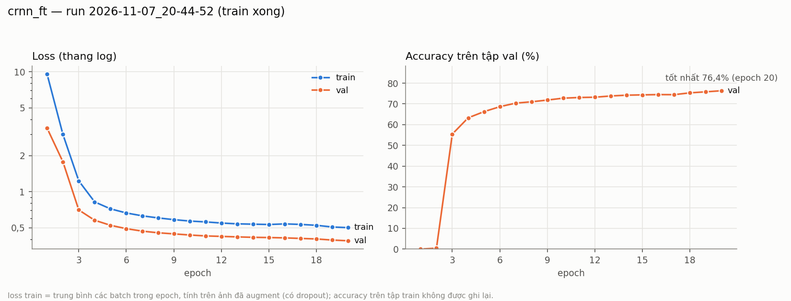
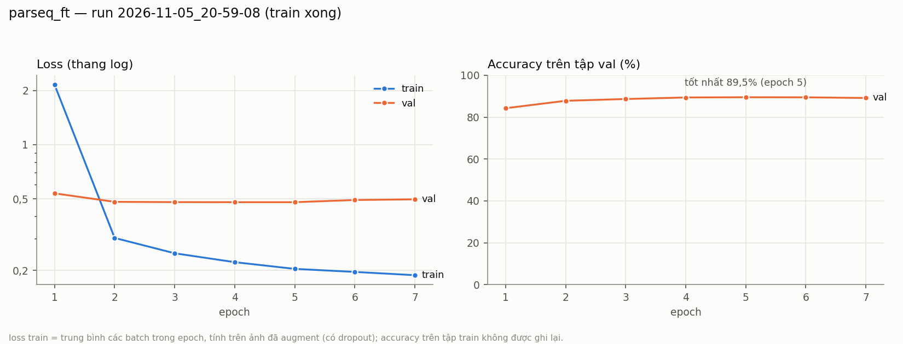

# Đường cong huấn luyện

Sinh tự động bởi `python -m trademark_ocr.train_curves` từ log TensorBoard của từng run. `epoch` đánh số từ 1, tính dồn qua các lần train tiếp. Loss train tính trên ảnh đã augment nên thường cao hơn val_loss — so **xu hướng** hai đường, không so độ lớn.

## crnn_ft

Run `crnn_ft/2026-11-04_21-58-41` — **train xong** (`DONE`).

| epoch | loss train | val_loss | val_accuracy (%) | val 1−NED (%) | ghi chú |
|---|---|---|---|---|---|
| 1 | 6,8885 | 2,5449 | 0,00 | 5,30 |  |
| 2 | 1,3157 | 0,6365 | 60,93 | 85,74 |  |
| 3 | 0,7338 | 0,5189 | 67,64 | 87,49 |  |
| 4 | 0,6431 | 0,4765 | 70,48 | 88,59 |  |
| 5 | 0,6020 | 0,4575 | 71,61 | 88,86 |  |
| 6 | 0,5769 | 0,4456 | 72,63 | 89,08 |  |
| 7 | 0,5632 | 0,4354 | 73,05 | 89,35 |  |
| 8 | 0,5503 | 0,4254 | 74,07 | 89,52 | tốt nhất |
| 8 | — | 0,4445 | 72,59 | 89,10 | model sau SWA |

**Kết luận:** chưa thấy overfit: val_loss vẫn giảm tới epoch 8 (0,4254); model còn học thêm được.

## parseq_ft

Run `parseq_ft/2026-11-05_20-59-08` — **train xong** (`DONE`).

| epoch | loss train | val_loss | val_accuracy (%) | val 1−NED (%) | ghi chú |
|---|---|---|---|---|---|
| 1 | 2,1533 | 0,5365 | 84,26 | 94,47 |  |
| 2 | 0,3033 | 0,4813 | 87,81 | 95,60 |  |
| 3 | 0,2492 | 0,4797 | 88,65 | 95,97 |  |
| 4 | 0,2224 | 0,4792 | 89,39 | 96,18 |  |
| 5 | 0,2041 | 0,4791 | 89,49 | 96,28 | tốt nhất |
| 6 | 0,1963 | 0,4927 | 89,46 | 96,23 |  |
| 7 | 0,1883 | 0,4969 | 89,14 | 96,23 |  |

**Kết luận:** val_loss thấp nhất ở epoch 5 (0,4791), 2 epoch sau đó đi ngang (epoch cuối 0,4969, +4%) — gần bão hoà, chưa rõ overfit.

## svtrctc

Run `svtrctc/2026-11-06_04-21-57` — **train xong** (`DONE`).

| epoch | loss train | val_loss | val_accuracy (%) | val 1−NED (%) | ghi chú |
|---|---|---|---|---|---|
| 1 | 6,1960 | 3,4441 | 0,00 | 0,00 |  |
| 2 | 3,3263 | 2,4724 | 0,74 | 36,34 |  |
| 3 | 2,0051 | 0,8851 | 50,46 | 78,45 |  |
| 4 | 1,3090 | 0,7054 | 61,38 | 82,25 |  |
| 5 | 1,1181 | 0,6392 | 64,86 | 83,77 |  |
| 6 | 0,9806 | 0,5984 | 68,13 | 84,32 |  |
| 7 | 0,8959 | 0,5807 | 69,22 | 84,93 |  |
| 8 | 0,8486 | 0,5627 | 69,75 | 85,10 |  |
| 9 | 0,8139 | 0,5439 | 71,08 | 86,08 |  |
| 10 | 0,7910 | 0,5325 | 71,82 | 85,93 | tốt nhất |
| 10 | — | 0,5611 | 70,52 | 85,36 | model sau SWA |

**Kết luận:** chưa thấy overfit: val_loss vẫn giảm tới epoch 10 (0,5325); model còn học thêm được.
