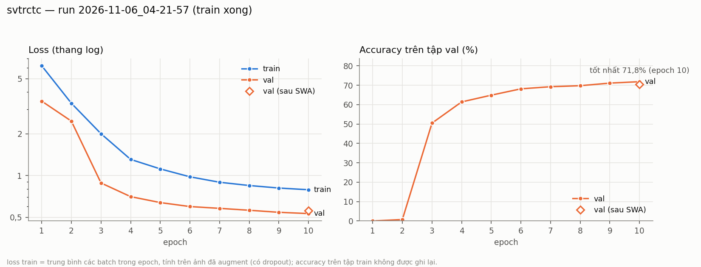
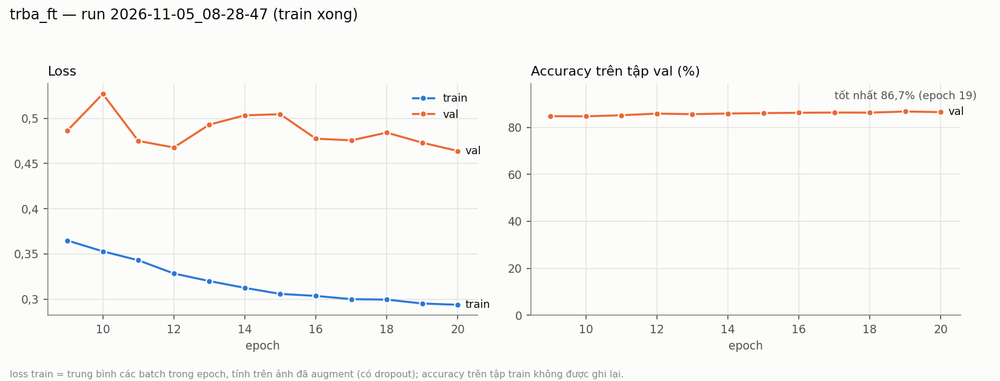

# Đường cong huấn luyện

Sinh tự động bởi `python -m trademark_ocr.train_curves` từ log TensorBoard của từng run. `epoch` đánh số từ 1, tính dồn qua các lần train tiếp. Loss train tính trên ảnh đã augment nên thường cao hơn val_loss — so **xu hướng** hai đường, không so độ lớn.

## crnn_ft

Run `crnn_ft/2026-11-07_20-44-52` — **chưa xong hoặc đang train** (`chưa xong`).

| epoch | loss train | val_loss | val_accuracy (%) | val 1−NED (%) | ghi chú |
|---|---|---|---|---|---|
| 1 | 9,5351 | 3,3840 | 0,00 | 0,00 |  |
| 2 | 2,9972 | 1,7728 | 0,46 | 42,34 |  |
| 3 | 1,2300 | 0,7039 | 55,45 | 84,01 |  |
| 4 | 0,8218 | 0,5779 | 63,28 | 86,25 |  |
| 5 | 0,7191 | 0,5244 | 66,27 | 87,29 |  |
| 6 | 0,6644 | 0,4916 | 68,66 | 87,81 |  |
| 7 | 0,6290 | 0,4690 | 70,38 | 88,39 |  |
| 8 | 0,6042 | 0,4542 | 71,01 | 88,66 |  |
| 9 | 0,5845 | 0,4448 | 71,86 | 88,93 |  |
| 10 | 0,5689 | 0,4352 | 72,77 | 89,21 |  |
| 11 | 0,5596 | 0,4276 | 73,08 | 89,38 |  |
| 12 | 0,5476 | 0,4238 | 73,23 | 89,36 |  |
| 13 | 0,5391 | 0,4197 | 73,82 | 89,59 |  |
| 14 | 0,5359 | 0,4164 | 74,21 | 89,68 |  |
| 15 | 0,5324 | 0,4144 | 74,35 | 89,73 |  |
| 16 | 0,5386 | 0,4119 | 74,49 | 89,67 |  |
| 17 | 0,5334 | 0,4075 | 74,46 | 89,79 |  |
| 18 | 0,5241 | 0,4034 | 75,33 | 89,86 |  |
| 19 | 0,5076 | 0,3950 | 75,83 | 90,01 |  |
| 20 | 0,5012 | 0,3896 | 76,35 | 90,27 | tốt nhất |

**Kết luận:** chưa thấy overfit: val_loss vẫn giảm tới epoch 20 (0,3896); model còn học thêm được.

## parseq_ft

Run `parseq_ft/2026-11-05_20-59-08` — **train xong** (`DONE`).

| epoch | loss train | val_loss | val_accuracy (%) | val 1−NED (%) | ghi chú |
|---|---|---|---|---|---|
| 1 | 2,1533 | 0,5365 | 84,26 | 94,47 |  |
| 2 | 0,3033 | 0,4813 | 87,81 | 95,60 |  |
| 3 | 0,2492 | 0,4797 | 88,65 | 95,97 |  |
| 4 | 0,2224 | 0,4792 | 89,39 | 96,18 |  |
| 5 | 0,2041 | 0,4791 | 89,49 | 96,28 | tốt nhất |
| 6 | 0,1963 | 0,4927 | 89,46 | 96,23 |  |
| 7 | 0,1883 | 0,4969 | 89,14 | 96,23 |  |

**Kết luận:** val_loss thấp nhất ở epoch 5 (0,4791), 2 epoch sau đó đi ngang (epoch cuối 0,4969, +4%) — gần bão hoà, chưa rõ overfit.

## svtrctc

Run `svtrctc/2026-11-06_04-21-57` — **train xong** (`DONE`).

| epoch | loss train | val_loss | val_accuracy (%) | val 1−NED (%) | ghi chú |
|---|---|---|---|---|---|
| 1 | 6,1960 | 3,4441 | 0,00 | 0,00 |  |
| 2 | 3,3263 | 2,4724 | 0,74 | 36,34 |  |
| 3 | 2,0051 | 0,8851 | 50,46 | 78,45 |  |
| 4 | 1,3090 | 0,7054 | 61,38 | 82,25 |  |
| 5 | 1,1181 | 0,6392 | 64,86 | 83,77 |  |
| 6 | 0,9806 | 0,5984 | 68,13 | 84,32 |  |
| 7 | 0,8959 | 0,5807 | 69,22 | 84,93 |  |
| 8 | 0,8486 | 0,5627 | 69,75 | 85,10 |  |
| 9 | 0,8139 | 0,5439 | 71,08 | 86,08 |  |
| 10 | 0,7910 | 0,5325 | 71,82 | 85,93 | tốt nhất |
| 10 | — | 0,5611 | 70,52 | 85,36 | model sau SWA |

**Kết luận:** chưa thấy overfit: val_loss vẫn giảm tới epoch 10 (0,5325); model còn học thêm được.

## trba_ft

Run `trba_ft/2026-11-05_08-28-47` — **train xong** (`DONE`).

| epoch | loss train | val_loss | val_accuracy (%) | val 1−NED (%) | ghi chú |
|---|---|---|---|---|---|
| 9 | 0,3649 | 0,4863 | 84,75 | 93,62 |  |
| 10 | 0,3529 | 0,5270 | 84,68 | 93,64 |  |
| 11 | 0,3430 | 0,4750 | 85,14 | 93,61 |  |
| 12 | 0,3284 | 0,4677 | 85,84 | 93,88 |  |
| 13 | 0,3200 | 0,4930 | 85,59 | 93,78 |  |
| 14 | 0,3125 | 0,5033 | 85,87 | 94,00 |  |
| 15 | 0,3058 | 0,5045 | 86,05 | 94,02 |  |
| 16 | 0,3036 | 0,4775 | 86,19 | 94,06 |  |
| 17 | 0,3000 | 0,4756 | 86,30 | 93,96 |  |
| 18 | 0,2995 | 0,4842 | 86,26 | 94,03 |  |
| 19 | 0,2952 | 0,4730 | 86,72 | 93,99 | tốt nhất |
| 20 | 0,2938 | 0,4639 | 86,47 | 93,88 |  |

**Kết luận:** chưa thấy overfit: val_loss vẫn giảm tới epoch 20 (0,4639); model còn học thêm được.
